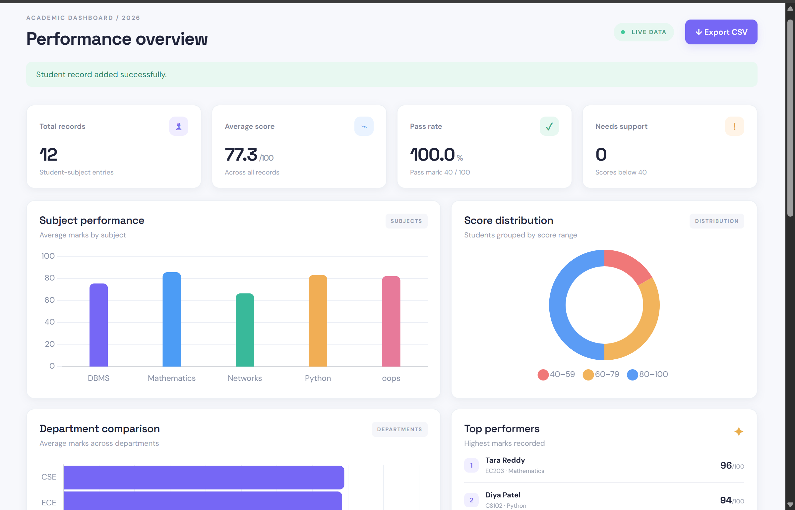
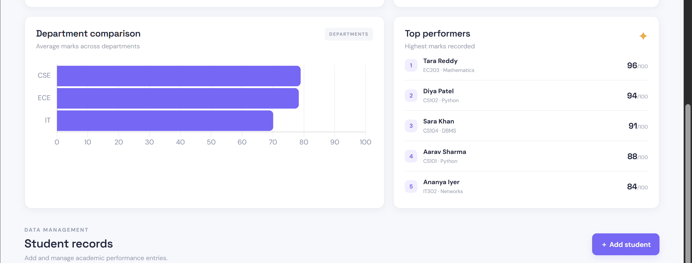

# GradeScope — Student Performance Analytics System

A college-level mini project built with **Python, Flask, SQLite, HTML, CSS and Chart.js**. It stores student subject marks and converts them into useful academic insights through an interactive dashboard.

## Features
- Dashboard KPIs: total records, average score, pass rate and students needing support.
- Visual analytics: subject averages, score distribution and department comparison.
- Student record management: add and delete student-subject entries.
- Search records instantly in the table.
- Export all records to CSV.
- Sample dataset automatically loads on first run.
- Input validation and unique roll-number constraint.

## Tech stack
- Backend: Python + Flask
- Database: SQLite
- Frontend: HTML, CSS, JavaScript
- Charts: Chart.js

## Run locally

### 1. Requirements
Install Python 3.10 or later.

### 2. Open the project folder in a terminal

```bash
cd student_performance_analytics
```

### 3. Create a virtual environment

Windows:
```bash
py -m venv venv
venv\Scripts\activate
```

macOS / Linux:
```bash
python3 -m venv venv
source venv/bin/activate
```

### 4. Install dependencies

```bash
pip install -r requirements.txt
```

### 5. Start the application

```bash
python app.py
```

Open **http://127.0.0.1:5000** in your browser. The SQLite database and sample records are created automatically.

## Database design

**Students** table:

| Column | Type | Description |
|---|---|---|
| id | INTEGER, primary key | Unique record identifier |
| name | TEXT | Student name |
| roll_no | TEXT, unique | Student roll number |
| department | TEXT | Department |
| semester | INTEGER | Semester number |
| subject | TEXT | Subject name |
| marks | REAL | Marks out of 100 |

Each row represents a student's performance in one subject. For this compact project, roll number is unique per record; to record multiple subjects for the same student, extend the schema to use a separate Students table and a related Marks table.

## Analytics logic
- Average score = sum of all marks / number of records.
- Pass rate = (records with marks >= 40 / total records) × 100.
- At-risk count = records with marks below 40.
- Subject and department averages are calculated using SQL `AVG()` and `GROUP BY`.

## Project structure

```text
student_performance_analytics/
├── app.py
├── requirements.txt
├── README.md
├── .gitignore
├── students.db          # generated on first run; not committed
├── templates/
│   └── index.html
└── static/
    └── style.css
```

## Notes
- Chart.js is loaded from a CDN, so an internet connection is required for charts to render.
- This is a demonstration/academic project. Use fictional or anonymized student data.
- For production use, add authentication, CSRF protection, role-based access, stronger validation and a normalized database schema.
---

## 📸 Project Screenshots

### 1. Dashboard


### 2. Student Performance Analytics


### 3. Student Records


---

## 🚀 Future Enhancements

- Student login and authentication
- Faculty login system
- Attendance tracking
- Predictive student performance analysis
- PDF report generation